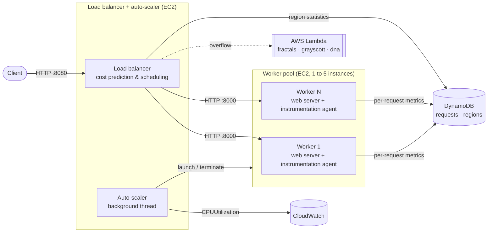

# Nature@Cloud

> An elastic, cost-aware cloud platform for compute-heavy scientific workloads, with a custom load balancer, a custom auto-scaler, bytecode-level request profiling and serverless offloading on AWS.


Nature@Cloud exposes three CPU- and memory-intensive workloads over HTTP (fractal rendering, reaction-diffusion simulation and DNA sequence matching) and serves them from a pool of EC2 workers that grows and shrinks with demand. Instead of relying on a managed load balancer, every routing and scaling decision is made by a purpose-built Java service that **predicts the cost of each request before it runs** and places it accordingly: on the least-loaded worker, packed onto a busy one so others can drain, or offloaded to AWS Lambda when the cluster is saturated.

**➡️ To build, run locally or deploy to AWS, see [SETUP.md](SETUP.md).**

---

## Table of contents

- [Highlights](#highlights)
- [Architecture](#architecture)
- [How it works](#how-it-works)
- [Workloads & API](#workloads--api)
- [Repository structure](#repository-structure)
- [Quick start](#quick-start)
- [Performance analysis](#performance-analysis)
- [Authors](#authors)

---

## Highlights

- **Cost prediction per request.** Each request is estimated in instructions and memory *before* dispatch, using analytical models fitted to profiling data and refined online with real measurements.
- **Bytecode instrumentation.** A Javassist agent rewrites workload classes at load time to count executed instructions, memory accesses and allocated bytes per request, without touching workload code.
- **Self-improving estimates.** Measurements are persisted in DynamoDB and aggregated per parameter region; once enough samples exist, the load balancer blends them with the analytical model (up to 90 % weight).
- **Adaptive scheduling.** The load balancer switches between *spreading* (balance load under pressure) and *packing* (consolidate when idle so workers can be scaled in), with admission control on load, memory and concurrency.
- **Custom auto-scaler.** Combines CloudWatch CPU metrics with the load balancer's own view of outstanding work, with hysteresis and cooldowns to avoid flapping. Workers are drained before termination.
- **Serverless overflow.** Requests predicted to be cheap enough go to AWS Lambda when no worker has capacity, cutting tail latency without over-provisioning EC2.
- **Fault tolerance.** A failed forward marks the worker unhealthy and retries the request on another node.

---

## Architecture



| Component | Module | Role |
|-----------|--------|------|
| **Load balancer & auto-scaler** | [`loadbalancer/`](loadbalancer) | Single Java process on its own EC2 instance. Predicts request cost, picks a worker or Lambda, and runs the scaling loop. |
| **Worker web server** | [`webserver/`](webserver) | Lightweight HTTP server (JDK `HttpServer`) exposing the three workloads on port 8000. |
| **Instrumentation agent** | [`javassist/`](javassist) | Java agent that instruments workload bytecode and records per-request metrics. |
| **Metrics Storage System (MSS)** | [`javassist/.../mss`](javassist/src/main/java/com/naturecloud/javassist/mss) | DynamoDB access layer: raw request metrics plus running averages per parameter region. |
| **Workloads** | [`fractals/`](fractals), [`grayscott/`](grayscott), [`dna/`](dna) | Each exposes the same logic as an HTTP handler, an AWS Lambda handler and a CLI entry point. |

---

## How it works

### 1. Request cost prediction

When a request arrives, the load balancer parses its parameters and estimates:

- **Instructions**, from a per-workload analytical model (e.g. `pixels × instructions-per-pixel` for fractals, `candidatePairs × cost-per-candidate` for DNA) fitted from instrumented runs.
- **Memory used**, from an allocated-memory model and a fitted *allocated → used* conversion, multiplied by a safety factor.

The parameter space is divided into **regions**. Workers report the measured cost of every completed request to DynamoDB, where per-region running averages are maintained. Once a region has at least 3 samples, predictions blend the model with the observed average, trusting observations more as they accumulate (50 % → 75 % → 90 %). Region statistics are cached in the load balancer and refreshed asynchronously, so prediction never blocks on DynamoDB.

The estimate is then normalised into **load units** against each workload's measured per-worker capacity, so different workloads are compared on the same scale.

### 2. Scheduling

| Cluster utilisation | Mode | Behaviour |
|---------------------|------|-----------|
| ≥ 85 % | **Spreading** | Send to the eligible worker with the least outstanding load. |
| ≤ 25 % | **Packing** | Send to the busiest eligible worker, leaving others idle so they can be scaled in. |
| in between | unchanged | Keep the previous mode (hysteresis). |

A worker is eligible only if the request fits its remaining load capacity, its memory admission limit (65 % of the memory budget) and its concurrency limit (4 in-flight requests). If no worker is eligible, the request goes to **Lambda** when its predicted instructions and memory are under the serverless thresholds; otherwise it waits briefly for capacity and returns `503` if none frees up.

### 3. Auto-scaling

Every 15 seconds the auto-scaler:

1. Promotes `STARTING` workers to `ACTIVE` once they pass a health check.
2. Terminates `DRAINING` workers that have finished all in-flight requests.
3. Reads mean `CPUUtilization` from CloudWatch (detailed monitoring) alongside the load balancer's own load and memory utilisation.
4. **Scales out** when either CPU (> 85 %) or predicted load/memory is high for 2 consecutive cycles (90 s cooldown), and **scales in** only when CPU (< 25 %) *and* predicted load/memory are both low for 4 consecutive cycles (180 s cooldown), always between 1 and 5 workers.

Scale-in never kills a busy worker: the least-loaded one is moved to `DRAINING`, stops receiving new requests, and is terminated only once idle.

### 4. Instrumentation

Workers start with the instrumentation agent attached:

```
-javaagent:webserver.jar=ICount:<packages to instrument>:<output dir>
```

The `ICount` tool injects counters into every basic block of the workload classes, tracking instructions, memory accesses and per-thread allocated bytes. When a request finishes, its metrics and parameters are stored through the MSS.

---

## Workloads & API

All endpoints are `GET` and are served by both the load balancer (`:8080`) and the workers (`:8000`). Every parameter is optional and falls back to the default shown.

### `/fractals` · Julia set renderer

| Parameter | Default | Description |
|-----------|---------|-------------|
| `w` | `800` | Image width (px) |
| `h` | `600` | Image height (px) |
| `iterations` | `100` | Maximum escape iterations |

Returns a `data:image/png;base64,...` string.

### `/grayscott` · Gray–Scott reaction-diffusion

| Parameter | Default | Description |
|-----------|---------|-------------|
| `size` | `256` | Grid side length |
| `maxIterations` | `5000` | Simulation steps |
| `f` | `0.030` | Feed rate |
| `k` | `0.062` | Kill rate |
| `stopOnExtinction` | `false` | Stop early when the pattern dies out |
| `seedMode` | `center` | Initial seed: `center`, `ring` or `stripe` |

Returns a `data:image/png;base64,...` string.

### `/dna` · Shared-substring finder for two DNA sequences

| Parameter | Default | Description |
|-----------|---------|-------------|
| `seq1` | `seq1:ATGC` | `[name:]<FASTA content>` (URL-encoded) |
| `seq2` | `seq2:ATGC` | `[name:]<FASTA content>` (URL-encoded) |
| `minLength` | `1` | Minimum match length |
| `stopOnFirst` | `false` | Stop after the first match |

Returns an HTML page highlighting the matching regions. Sample FASTA files (HBB gene for human, chimpanzee and Norway rat) are in [`dna/src/main/resources`](dna/src/main/resources).

### Examples

```bash
curl "http://localhost:8000/fractals?w=1024&h=768&iterations=250"
curl "http://localhost:8000/grayscott?size=200&maxIterations=3000&f=0.035&k=0.065&seedMode=ring"
curl "http://localhost:8000/dna?seq1=a:ACGTACGTTT&seq2=b:TTACGTACGA&minLength=4"
```

---

## Repository structure

```
.
├── pom.xml                  # Maven parent (multi-module build)
├── fractals/                # Julia set workload
├── grayscott/               # Gray–Scott reaction-diffusion workload
├── dna/                     # DNA matching workload (+ sample FASTA files)
├── javassist/               # Instrumentation agent, metrics model, DynamoDB storage (MSS)
├── webserver/               # Worker HTTP server
├── loadbalancer/            # Load balancer + auto-scaler
├── aws/scripts/             # Provisioning and teardown scripts (AWS CLI)
├── resultTestsAndPseudo/    # Profiling data, fitted cost models, calibration and stress tests
├── README.md
└── SETUP.md                 # Build, local run and AWS deployment guide
```

---

## Quick start

```bash
# Build every module (Java 11+, Maven 3.6+)
mvn clean package

# Render a fractal locally, no AWS needed
java -cp fractals/target/fractals-1.0.0-SNAPSHOT-jar-with-dependencies.jar \
     com.naturecloud.fractals.FractalsHandler 800 600 200 julia.png
```

Running the instrumented web server, the load balancer, or the full AWS deployment is covered step by step in **[SETUP.md](SETUP.md)**.

---

## Performance analysis

The [`resultTestsAndPseudo/`](resultTestsAndPseudo) folder holds the data behind the cost models and capacity figures used by the load balancer: instrumented profiling runs per workload, the fitted instruction and memory heuristics, single-worker calibration and saturation tests, stress tests under concurrent load, and pseudocode of the load balancer and auto-scaler. See [its README](resultTestsAndPseudo/README.md) for a guide.

---

## Authors

- **Your Name** · [@your-github](https://github.com/your-github)
- **Collaborator Name** · [@collaborator](https://github.com/collaborator)
- **Collaborator Name** · [@collaborator](https://github.com/collaborator)
