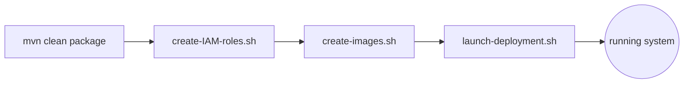

# Setup guide

This guide covers building Nature@Cloud, running its components on your machine, and deploying the full system to AWS. For an overview of what the system does and how it works, see the [README](README.md).

## Contents

1. [Prerequisites](#1-prerequisites)
2. [Build](#2-build)
3. [Run locally](#3-run-locally)
4. [Deploy to AWS](#4-deploy-to-aws)
5. [Tear down](#5-tear-down)
6. [Configuration reference](#6-configuration-reference)
7. [Troubleshooting](#7-troubleshooting)

---

## 1. Prerequisites

| Tool | Needed for | Notes |
|------|------------|-------|
| **JDK 11+** | everything | Developed against Amazon Corretto 11; the deployment installs Corretto 11 on the instances. |
| **Maven 3.6+** | building | |
| **AWS account** | instrumented web server, load balancer, deployment | The scripts use EC2, Lambda, DynamoDB, CloudWatch and IAM. |
| **AWS CLI v2** | deployment | |
| `jq`, `nc` (netcat), `ssh`, `scp`, `curl` | deployment | Used by the scripts in `aws/scripts/`. |

> [!WARNING]
> The AWS deployment creates billable resources: EC2 instances, AMIs and EBS snapshots, Lambda functions, DynamoDB tables (5 RCU / 5 WCU each) and IAM roles. Always run the [tear-down](#5-tear-down) steps when you are done.

---

## 2. Build

From the repository root:

```bash
mvn clean package
```

The parent `pom.xml` builds the modules in dependency order:

| Module | Output (`<module>/target/`) | Depends on |
|--------|-----------------------------|------------|
| `javassist` | `javassist-1.0.0-SNAPSHOT-jar-with-dependencies.jar` | Javassist, AWS SDK v2 (DynamoDB, EC2, CloudWatch) |
| `fractals` | `fractals-1.0.0-SNAPSHOT-jar-with-dependencies.jar` | AWS Lambda core |
| `dna` | `dna-1.0.0-SNAPSHOT-jar-with-dependencies.jar` | AWS Lambda core, Jackson |
| `grayscott` | `grayscott-1.0.0-SNAPSHOT-jar-with-dependencies.jar` | AWS Lambda core |
| `webserver` | `webserver-1.0.0-SNAPSHOT-jar-with-dependencies.jar` | the three workloads + `javassist` |
| `loadbalancer` | `loadbalancer-1.0.0-SNAPSHOT-jar-with-dependencies.jar` | `javassist`, AWS SDK v2 (EC2, CloudWatch, DynamoDB, Lambda) |

Every JAR is self-contained (`jar-with-dependencies`). The `webserver` JAR also carries the agent manifest (`Premain-Class: com.naturecloud.javassist.JavassistAgent`), so it doubles as the `-javaagent` JAR.

---

## 3. Run locally

### 3.1 Workloads from the command line (no AWS)

Each workload has a CLI entry point, handy for testing or profiling a single run.

```bash
# Julia set → PNG
java -cp fractals/target/fractals-1.0.0-SNAPSHOT-jar-with-dependencies.jar \
     com.naturecloud.fractals.FractalsHandler <width> <height> <iterations> <output.png>

# Gray–Scott → PNG
java -cp grayscott/target/grayscott-1.0.0-SNAPSHOT-jar-with-dependencies.jar \
     com.naturecloud.grayscott.GrayScottHandler <size> <maxIterations> <feedF> <killK> \
     <stopOnExtinction:true|false> <seedMode:center|ring|stripe> [output.png]

# DNA matching → dna-match-result.html
java -cp dna/target/dna-1.0.0-SNAPSHOT-jar-with-dependencies.jar \
     com.naturecloud.dna.DnaHandler [name1:]<fasta1> [name2:]<fasta2> [minLength] [stopOnFirst]
```

Example:

```bash
java -cp fractals/target/fractals-1.0.0-SNAPSHOT-jar-with-dependencies.jar \
     com.naturecloud.fractals.FractalsHandler 800 600 200 julia.png
```

### 3.2 Worker web server

The web server calls `MSS.ensureTablesExist()` on startup, which creates the DynamoDB tables `naturecloud-requests` and `naturecloud-regions` if they don't exist. It therefore needs AWS credentials and a default region, resolved through the standard AWS SDK chain:

```bash
aws configure            # or: export AWS_PROFILE=... / AWS_REGION=us-east-1
```

**Plain** (serves requests, no metrics):

```bash
java -cp webserver/target/webserver-1.0.0-SNAPSHOT-jar-with-dependencies.jar \
     com.naturecloud.webserver.WebServer
```

**Instrumented** (exactly how workers run in production; every request's metrics are written to DynamoDB):

```bash
java -cp webserver/target/webserver-1.0.0-SNAPSHOT-jar-with-dependencies.jar \
     -Xbootclasspath/a:javassist/target/javassist-1.0.0-SNAPSHOT-jar-with-dependencies.jar \
     -javaagent:webserver/target/webserver-1.0.0-SNAPSHOT-jar-with-dependencies.jar=ICount:com.naturecloud.fractals,com.naturecloud.grayscott,com.naturecloud.dna:output \
     com.naturecloud.webserver.WebServer
```

The agent argument has the form `<ToolName>:<comma-separated packages>:<output dir>`; instrumented class files are written to `output/`.

Test it:

```bash
curl "http://localhost:8000/test?hello"
curl "http://localhost:8000/fractals?w=400&h=300&iterations=100"
```

### 3.3 Load balancer

The load balancer is designed to run inside AWS: at startup it looks up the newest AMI named `NatureCloud-Worker-Image` in your account and immediately launches a worker EC2 instance from it. Run it only after completing the AWS image step ([4.4](#44-bake-the-amis)) and the configuration in [4.2](#42-set-your-own-values):

```bash
java -cp loadbalancer/target/loadbalancer-1.0.0-SNAPSHOT-jar-with-dependencies.jar \
     com.naturecloud.loadbalancer.Main
```

It listens on port `8080`.

---

## 4. Deploy to AWS

### Overview



| Script | What it does |
|--------|--------------|
| `create-IAM-roles.sh` | Creates `naturecloud-worker-role` (DynamoDB + Lambda basic execution) and `naturecloud-lbas-role` (DynamoDB, EC2, CloudWatch read, and permission to pass the worker role), each with an instance profile of the same name. |
| `create-images.sh` | Builds two AMIs. For each: launches a `t3.micro` Amazon Linux 2023 instance, installs Corretto 11, copies the built module(s) over SSH, registers the service in `/etc/rc.d/rc.local` so it starts on boot, reboots to verify, creates the AMI and terminates the instance. Produces `NatureCloud-Worker-Image` and `NatureCloud-LBAS-Image`, then deletes the DynamoDB tables created during the boot test. |
| `launch-deployment.sh` | Launches the load balancer instance from `NatureCloud-LBAS-Image` and deploys the three Lambda functions from the workload JARs. |

All scripts must be run **from `aws/scripts/`**, because they `source config.sh` from the current directory. Intermediate IDs are stored there in `instance.id`, `instance.dns`, `image.id`, `instanceLBAS.id`, `instanceLBAS.dns` and `imageLBAS.id`.

### 4.1 Prepare your AWS account

1. **Key pair.** In the EC2 console (region `us-east-1`), create a key pair and save the `.pem` file, e.g. `~/.ssh/my-key.pem`, with `chmod 400`.
2. **Security group.** Create a security group with these inbound rules:

   | Port | Source | Purpose |
   |------|--------|---------|
   | 22 | your IP | SSH, used by `create-images.sh` |
   | 8080 | your IP (or wherever clients are) | Load balancer |
   | 8000 | the security group itself | Load balancer → workers (also used by the image boot test, so your IP too) |

3. **Credentials.** Create an IAM user or SSO profile with permissions for EC2, IAM, Lambda, DynamoDB and CloudWatch.

### 4.2 Set your own values

A few deployment values are hard-coded and must be replaced with your own before building and deploying.

**`aws/scripts/config.sh`**

```bash
export PATH=$DIR/../bin:$PATH
export AWS_DEFAULT_REGION=<your-aws-region>
export AWS_ACCOUNT_ID=<your-aws-account-id>
export AWS_ACCESS_KEY_ID=<your-access-key-id>
export AWS_SECRET_ACCESS_KEY=<your-secret-access-key>
export AWS_EC2_SSH_KEYPAIR_PATH=<path-to-your-ssh-keypair>
export AWS_SECURITY_GROUP=<your-security-group-id>
export AWS_KEYPAIR_NAME=<your-keypair-name>
```

> [!CAUTION]
> Never commit real access keys. After filling in `config.sh`, keep it out of version control, for example with `git update-index --assume-unchanged aws/scripts/config.sh`. A named CLI profile (`aws configure --profile ...` plus `export AWS_PROFILE=...`) avoids putting keys in the file at all.

**`aws/scripts/create-IAM-roles.sh`** (the `PassWorkerRole` policy): replace the account ID in

```
"Resource":"arn:aws:iam::<account-id>:role/naturecloud-worker-role",
```

**`loadbalancer/src/main/java/com/naturecloud/loadbalancer/Main.java`**: the auto-scaler launches workers with these values, so set them to the same key pair and security group:

```java
private static final String KEY_NAME = "<your key pair name>";
private static final String SECURITY_GROUP = "<your security group id>";
```

The AWS region (`us-east-1`) is also fixed in `Main.java` (`Region.US_EAST_1`) and in the scripts' `config.sh`.

### 4.3 Build

```bash
mvn clean package
```

The image step copies the built `target/` folders onto the instances, so build first and rebuild after any change to `Main.java`.

### 4.4 Create the IAM roles and bake the AMIs

```bash
cd aws/scripts
./create-IAM-roles.sh
sleep 15                  # give IAM a few seconds to propagate the new instance profiles
./create-images.sh        # takes several minutes
```

### 4.5 Launch

```bash
./launch-deployment.sh
```

Once the load balancer instance boots, its auto-scaler launches the first worker on its own (expect a couple of minutes before the worker is `ACTIVE`). Find the load balancer's public address:

```bash
aws ec2 describe-instances \
  --filters "Name=image-id,Values=$(cat imageLBAS.id)" "Name=instance-state-name,Values=running" \
  --query 'Reservations[].Instances[].PublicDnsName' --output text
```

Then send requests to port `8080`:

```bash
LB=<load-balancer-public-dns>
curl "http://$LB:8080/test?ping"
curl "http://$LB:8080/fractals?w=800&h=600&iterations=100"
curl "http://$LB:8080/grayscott?size=256&maxIterations=5000"
curl "http://$LB:8080/dna?seq1=a:ACGTACGTTT&seq2=b:TTACGTACGA&minLength=4"
```

---

## 5. Tear down

From `aws/scripts/`:

```bash
./delete-deployment.sh    # terminates instances and deletes the three Lambda functions
./deregister-image.sh     # deregisters both AMIs and deletes their snapshots
./delete-dynamo.sh        # deletes naturecloud-requests and naturecloud-regions
./delete-IAM-roles.sh     # detaches policies, deletes instance profiles and roles
```

> [!WARNING]
> `delete-deployment.sh` terminates **every EC2 instance in the configured region** of the account, not only Nature@Cloud ones. Use a dedicated account or region, or terminate the instances manually if anything else runs there.

---

## 6. Configuration reference

### AWS resources

| Resource | Name / value |
|----------|--------------|
| Region | `us-east-1` |
| Instance type | `t3.micro`, Amazon Linux 2023, detailed monitoring enabled |
| AMIs | `NatureCloud-Worker-Image`, `NatureCloud-LBAS-Image` |
| IAM roles / instance profiles | `naturecloud-worker-role`, `naturecloud-lbas-role` |
| Lambda functions | `naturecloud-fractals`, `naturecloud-grayscott`, `naturecloud-dna` (Java 11, 512 MB, 120 s timeout) |
| DynamoDB tables | `naturecloud-requests` (partition key `function`), `naturecloud-regions` (partition key `function`, sort key `regionKey`), 5 RCU / 5 WCU |
| Ports | load balancer `8080`, workers `8000` |

### Load balancer tuning

All tuning constants live at the top of [`Main.java`](loadbalancer/src/main/java/com/naturecloud/loadbalancer/Main.java):

| Constant | Default | Meaning |
|----------|---------|---------|
| `MIN_WORKERS` / `MAX_WORKERS` | 1 / 5 | Worker pool bounds |
| `SCALE_INTERVAL_MS` | 15 000 | Auto-scaler tick |
| `SCALE_OUT_COOLDOWN_MS` / `SCALE_IN_COOLDOWN_MS` | 90 000 / 180 000 | Minimum time between scaling actions |
| `SCALE_OUT_REQUIRED_CYCLES` / `SCALE_IN_REQUIRED_CYCLES` | 2 / 4 | Consecutive cycles required before acting |
| `CW_CPU_SCALE_OUT_THRESHOLD` / `CW_CPU_SCALE_IN_THRESHOLD` | 85 / 25 | Mean CloudWatch CPU (%) |
| `HIGH_UTILIZATION` / `LOW_UTILIZATION` | 0.85 / 0.25 | Switch to spreading / packing |
| `MAX_CONCURRENT_PER_WORKER` | 4 | In-flight requests per worker |
| `MEMORY_ADMISSION_UTIL_LIMIT` | 0.65 | Fraction of the worker memory budget that can be reserved |
| `MEMORY_SAFETY_FACTOR` | 1.25 | Multiplier on predicted memory |
| `LAMBDA_COST_THRESHOLD` | 500 000 000 | Max predicted instructions for Lambda offload |
| `LAMBDA_MEMORY_THRESHOLD` | 200 MB | Max predicted memory for Lambda offload |
| `MIN_REGION_SAMPLES` | 3 | Samples before observed averages are used |

---

## 7. Troubleshooting

| Symptom | Likely cause / fix |
|---------|--------------------|
| Load balancer exits at startup with `ExceptionInInitializerError` (caused by a `NullPointerException`) | No AMI named `NatureCloud-Worker-Image` is owned by the account in `us-east-1`. Run `create-images.sh` first. |
| `create-images.sh` hangs on "Waiting for …:22 (SSH)" | Port 22 is not open to your IP in the security group, or the key pair path/name in `config.sh` is wrong. |
| `create-images.sh` hangs on "Waiting for …:8000" / ":8080" | The service didn't start after reboot. SSH in and run the command from `/etc/rc.d/rc.local` by hand to see the error (often missing AWS permissions on the instance role). |
| `Invalid IAM Instance Profile name` | The roles were just created; wait a few seconds and retry. |
| `ERROR: JAR not found` from `launch-deployment.sh` | Run `mvn clean package` from the repository root first. |
| Workers launch but never become `ACTIVE` | The load balancer can't reach them on port 8000: allow inbound 8000 from the security group itself. |
| Requests return `503` | No worker had capacity within 30 s and the request was too large for Lambda. Wait for scale-out or reduce request size. |
| `ResourceInUseException` while deleting/creating tables | A table is still being created or deleted; wait and retry. |
